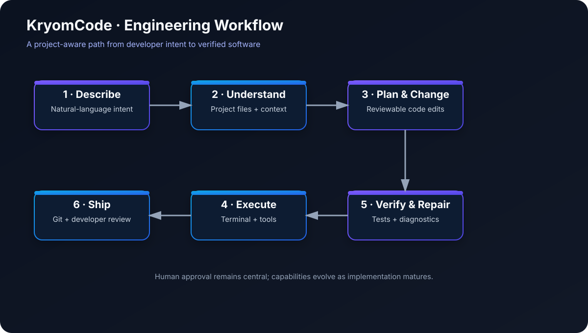
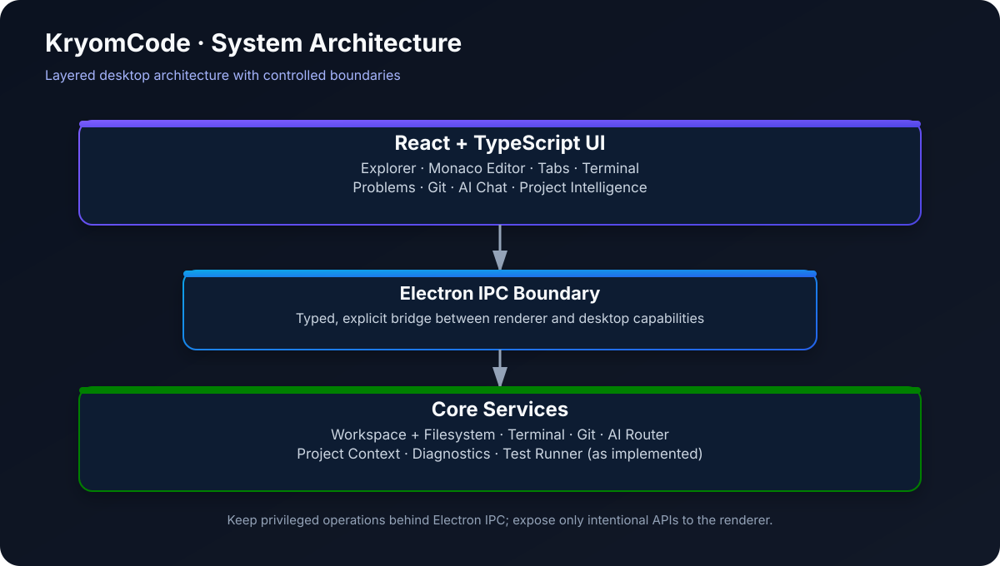
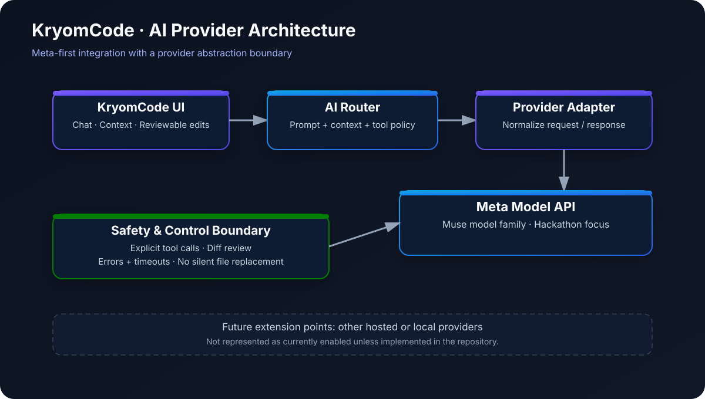
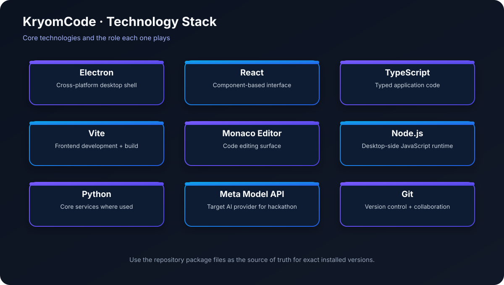
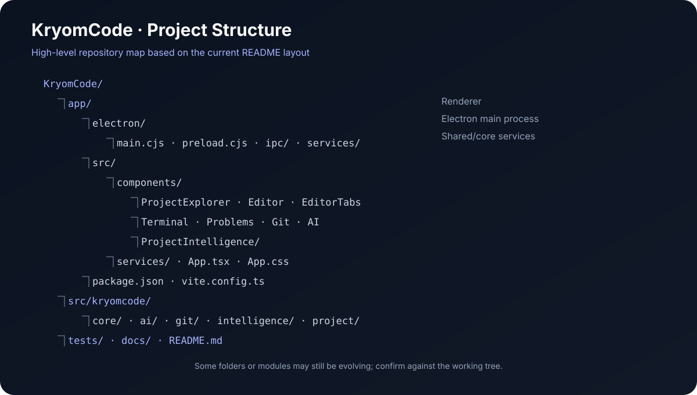

# KryomCode

## From Idea to Working Software

**An AI-native desktop development environment for understanding projects, editing code, running tools, testing changes, and shipping software.**

[](https://www.electronjs.org/)
[](https://react.dev/)
[](https://www.typescriptlang.org/)
[](https://vite.dev/)
[](https://git-scm.com/)
[](https://cerebralvalley.ai/e/meta-ai-developer-hackathon)

</div>

---

</p align="center">
  <imgsrc="assets/kryomcode-overview.png" alt="KryomCode overview infographic showing the IDE, workflow, architecture, stack, and project layout" width="100%" />
</p>

> **Core principle:** AI should operate on the project—not merely talk about the project.

KryomCode brings the everyday development loop into one desktop workspace: inspect a codebase, work in a full editor, use an integrated terminal, review diagnostics, and manage Git changes. The AI layer is being developed with a **Meta-first provider strategy** for the hackathon.

## Contents

- [Vision](#vision)
- [Features](#features)
- [Workflow](#workflow)
- [Architecture](#architecture)
- [AI provider architecture](#ai-provider-architecture)
- [Technology stack](#technology-stack)
- [Project structure](#project-structure)
- [Development status](#development-status)
- [Getting started](#getting-started)
- [Development commands](#development-commands)
- [Roadmap](#roadmap)
- [Contributing](#contributing)
- [License](#license)

## Vision

Software engineering is more than typing code. It includes architecture, project context, dependency management, terminal workflows, testing, debugging, version control, and release preparation.

KryomCode aims to make these activities feel connected while keeping the developer in control. The long-term direction is a project-aware engineering assistant that can plan and perform bounded tasks, show its proposed changes, and help verify results.

## Features

### Desktop IDE

- Electron desktop application with a React and TypeScript interface.
- Monaco Editor-based code editing experience.
- Project explorer for navigating a local workspace.
- Multiple editor tabs and file save workflows.
- Dark, developer-focused interface.

### Workspace and tools

- Open a local project folder and inspect its files.
- Create, rename, and delete files or folders where supported by the current build.
- Integrated PowerShell terminal for running project commands.
- Problems and diagnostics panel.
- Git status and diff-oriented workflow, with commit and GitHub push/pull support as implemented in the current branch.

### AI-native development direction

- AI chat interface designed around the active project.
- Project context can include selected files and workspace structure, subject to current implementation.
- Planned/ongoing work includes structured project intelligence, controlled tool execution, reviewable changes, and verification loops.
- **Hackathon provider focus: Meta Model API.** Keep provider capabilities and integration status aligned with the code currently in the repository.

## Workflow



The intended loop is: describe the task → understand relevant project context → plan changes → edit or generate code → execute tools/tests → review and repair → ship with Git. The exact level of automation depends on the features implemented in the current build.

## Architecture



KryomCode follows a layered desktop design:

1. **Renderer/UI** — React components for the editor and workspace panels.
2. **Electron IPC boundary** — explicit communication between the renderer and privileged desktop operations.
3. **Core services** — workspace/filesystem, terminal, Git, AI routing, and project-intelligence capabilities as they are implemented.

Keep filesystem and process operations behind narrow, validated IPC methods rather than exposing privileged Node.js APIs directly to the renderer.

## AI provider architecture



The intended design separates the UI from model-specific request handling:

- **AI UI:** gathers the user's request and relevant context.
- **AI Router:** selects the provider adapter and coordinates request/response handling.
- **Provider adapter:** translates application-level requests into provider-specific API calls.
- **Meta Model API:** the hackathon-first integration target.
- **Control boundary:** should support explicit tool permissions, reviewable diffs, useful errors, and safeguards against silent destructive edits.

The diagram shows the target architecture, not a guarantee that every box is already implemented. Alternative hosted or local providers are future extension points; Meta remains the current hackathon focus.

## Technology stack



| Technology | Role |
|---|---|
| Electron | Desktop application shell |
| React | UI components and workspace interface |
| TypeScript | Typed frontend code |
| Vite | Development server and frontend build tooling |
| Monaco Editor | Code editing surface |
| Node.js | Electron main-process and desktop-side JavaScript runtime |
| Python | Used by core services where present in the repository |
| Meta Model API | Planned/current hackathon AI provider target |
| Git and GitHub | Version control and remote repository workflow |

Check `app/package.json` and the repository's Python dependency files for the exact versions and currently installed dependencies.

## Project structure



High-level layout (verify exact files against the current branch):

```text
KryomCode/
├── app/
│   ├── electron/
│   │   ├── main.cjs
│   │   ├── preload.cjs
│   │   ├── ipc/
│   │   └── services/
│   ├── src/
│   │   ├── components/
│   │   │   ├── ProjectExplorer/
│   │   │   ├── Editor/
│   │   │   ├── EditorTabs/
│   │   │   ├── Terminal/
│   │   │   ├── Problems/
│   │   │   ├── Git/
│   │   │   ├── AI/
│   │   │   └── ProjectIntelligence/
│   │   ├── services/
│   │   ├── App.tsx
│   │   └── App.css
│   ├── package.json
│   └── vite.config.ts
├── src/
│   └── kryomcode/
│       ├── core/
│       ├── ai/
│       ├── git/
│       ├── intelligence/
│       └── project/
├── tests/
├── docs/
└── README.md
```

## Development status

KryomCode is an active, pre-release project. The table below intentionally distinguishes the desktop foundation from work that still needs verification in the current checkout.

| Area | Status |
|---|---|
| Electron + React + TypeScript application | Implemented foundation |
| Monaco editor and workspace UI | Implemented foundation |
| Project explorer and file operations | Verify against current build |
| Integrated terminal | Implemented foundation |
| Git / GitHub workflow | Push to GitHub has been verified by the developer; verify other actions separately |
| AI chat UI | UI foundation |
| Meta Model API integration | Hackathon focus; verify end-to-end API call before claiming complete |
| Project intelligence | In progress |
| Test runner and AI-assisted failure analysis | Planned / in progress |
| Autonomous engineering loop | Future roadmap |

**Demo status:** add a real demo video or GIF once the end-to-end flow has been recorded. Avoid presenting mock UI or planned capabilities as a working end-to-end feature.

## Getting started

### Prerequisites

- Windows 10/11 (the current primary development environment); other operating systems may require additional validation.
- Node.js and npm compatible with the app's package configuration.
- Git.
- Python only if running Python-based services or tests.

### Clone the repository

```bash
git clone https://github.com/KryomLabs/KryomCode.git
cd KryomCode
```

### Install frontend / desktop dependencies

```bash
cd app
npm install
```

### Start the desktop development app

```bash
npm run desktop:dev
```

### Build the frontend

```bash
npm run build
```

Run commands from the directory containing the relevant `package.json`. If a script name differs in the current branch, inspect available scripts with:

```bash
npm run
```

## Development commands

| Task | Command |
|---|---|
| Install app dependencies | `cd app && npm install` |
| List available npm scripts | `cd app && npm run` |
| Start desktop development | `cd app && npm run desktop:dev` |
| Build frontend | `cd app && npm run build` |
| Check working tree | `git status` |
| Commit changes | `git add .` then `git commit -m "Describe the change"` |
| Push current branch | `git push` |

## Roadmap

### Near term

- Finish and verify core IDE workflows.
- Complete Meta Model API integration and test real request/response handling.
- Ensure AI-generated changes are reviewable before being written to disk.
- Improve project context selection and diagnostics.
- Record a concise, reproducible demo.

### Next

- Reliable test runner and test-result presentation.
- Structured project intelligence across source, dependencies, tests, docs, and diagnostics.
- Agent loop: **Observe → Plan → Act → Verify → Repair**.
- Settings and secure API-key handling.
- Windows packaging first, followed by macOS/Linux validation.
- CI checks for build, lint, and tests.

### Long-term direction

Developer-controlled autonomy levels, from manual assistance to multi-step project tasks—with approval, pause, diff review, and rollback controls.

## Development philosophy

**Reliable foundations first, then deeper automation.**

Design → implement → test → verify at runtime → document → commit → iterate.

## Contributing

KryomCode is currently solo-built and pre-release. Bug reports, focused feature ideas, architecture discussions, and documentation improvements are welcome. For substantial changes, open an issue or discussion before starting implementation.

## License

The repository describes this project as MIT-licensed. Ensure a `LICENSE` file containing the MIT license is present in the repository before distributing it under that license.

## Links

- **Repository:** [KryomLabs/KryomCode](https://github.com/KryomLabs/KryomCode)
- **Hackathon:** [Meta AI Developer Hackathon](https://cerebralvalley.ai/e/meta-ai-developer-hackathon)

</p align="center">
  <b>KryomCode — AI-native software engineering. From Idea to Working Software.</b> <br/>
  Built with care for developers.
</p>
