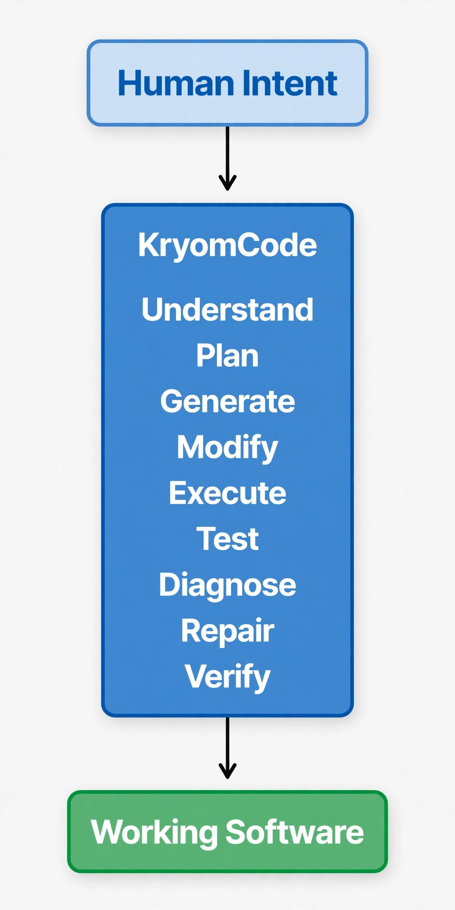

# KryomCode

## From Idea to Working Software

**KryomCode is an AI-native software engineering environment for planning, building, testing, debugging, and shipping software inside one intelligent IDE.**

> Core Principle: *The AI should operate on the project, not merely talk about the project.*

Built solo for the **Meta Global AI Developer Hackathon - Indie Track**. Built with Meta's newest models via Meta Model API.

---

## Demo

*2-min demo video coming soon - Idea prompt to working code inside KryomCode.*

What the demo shows:

1. Open a project folder
2. Ask AI in Cursor-style chat: "Create a FastAPI auth API with JWT"
3. AI understands project structure, creates files, edits code
4. Run tests from integrated terminal
5. Commit to GitHub without leaving the IDE

---

## Vision

Modern engineering is not just writing code. It is architecture, dependencies, terminals, testing, debugging, Git, docs, security, CI/CD and AI systems.

KryomCode brings it together:



The objective is not to replace developers. The objective is to increase developer leverage.

---

## Current Status

KryomCode is in active development. Hackathon MVP is functional.

### Current Progress

| Capability | Status |
|------------|--------|

| Desktop Application (Electron) | ✅ |
| Project Explorer | ✅ |
| File Reading / Saving | ✅ |
| Monaco Code Editor | ✅ |
| Multiple Editor Tabs | ✅ |
| Create / Rename / Delete File-Folder | ✅ |
| Integrated Terminal (PowerShell) | ✅ |
| Problems / Diagnostics | ✅ |
| Git Integration - status, diff, commit | ✅ |
| GitHub Integration | ✅ |
| AI Chat - Frontend (Cursor-style) | ✅ |
| Meta Model API Integration | ✅ |
| Project Intelligence - basic context | 🔄 |
| Test Runner | 🔄 |
| Autonomous Engineering | ⏭ |

---

## Features

### Project Explorer

- Open local project directories
- Browse nested files and folders
- Create, rename, delete files and folders
- Refresh and navigate large codebases

### Code Editor

Powered by Monaco Editor (VS Code engine):

- Syntax-aware editing
- Multiple tabs
- Fast file switching
- Auto-save

### Integrated Terminal

- PowerShell terminal inside project root
- Persistent process
- Run `python --version`, `npm install`, `pytest` directly
- Standard output and error streaming

### Git & GitHub Integration

- Git status and diff viewer
- Commit creation inside IDE
- Branch awareness
- GitHub push/pull workflow
- AI-assisted commit messages (planned)

### AI-Native Engineering - Frontend Complete

- Cursor-style AI chat panel
- Project-aware context: sends open files + folder structure to model
- Code generation directly into files
- AI Router architecture to avoid provider lock-in

**Hackathon integration:**

- Muse Spark series via Meta Model API
- Muse Wonder via Meta Model API
- Extensible to Muse Image and SAM 3.1

### Project Intelligence (In Progress)

Instead of isolated prompts, KryomCode builds structured understanding from:

- Project structure + source code + dependencies
- Config + Git history + tests + docs + diagnostics

---

## Architecture

Layered architecture to keep AI tools controlled and UI decoupled:

'''
+----------------------------------------+
| KryomCode UI                           |
| Explorer - Editor - Tabs - Terminal    |
| Problems - Git - AI Chat               |
+-------------------+--------------------+
                    |
                    v
+----------------------------------------+
| Electron IPC                           |
| Project - Filesystem - Terminal        |
+----------------------------------------+
                    |
                    v
+----------------------------------------+
| Core Services                          |
| Core - Project - Filesystem            |
| Intelligence - AI - Git                |
+----------------------------------------+
'''

The AI layer interacts through controlled tools and services, not directly with UI.

---

## Technology Stack

| Technology | Role |
|------------|------|

| Electron | Desktop runtime |
| React | UI |
| TypeScript | Frontend |
| Vite | Build tooling |
| Monaco Editor | Code editor |
| Node.js | Electron services |
| Python 3.11+ | Core services |
| Meta Model API | Muse Spark, Muse Wonder |
| Git | Version control |

---

## Project Structure

'''
KryomCode/
├── app/
│   ├── electron/
│   │   ├── main.cjs
│   │   ├── preload.cjs
│   │   ├── ipc/
│   │   └── services/
│   ├── src/
│   │   ├── components/
│   │   │   ├── ProjectExplorer/
│   │   │   ├── Editor/
│   │   │   ├── EditorTabs/
│   │   │   ├── Terminal/
│   │   │   ├── Problems/
│   │   │   ├── Git/
│   │   │   ├── AI/
│   │   │   └── ProjectIntelligence/
│   │   ├── services/
│   │   ├── App.tsx
│   │   └── App.css
│   ├── package.json
│   └── vite.config.ts
├── src/kryomcode/
│   ├── core/
│   ├── ai/
│   ├── git/
│   ├── intelligence/
│   └── project/
├── tests/
├── docs/
└── README.md
'''

---

## AI Provider Architecture

'''
        KryomCode
            |
        AI Router
            |
    Model Abstraction
            |
  +---------+----------+
  |         |          |
Meta API  OpenAI    Local Models
(Muse)

'''

Hackathon focus is Meta API first. Other providers pluggable later.

---

## Roadmap

### Hackathon MVP - Done for Nov 4 submission

- [x] VS Code-like layout
- [x] AI Chat frontend
- [x] Meta Model API connection
- [x] GitHub integration
- [x] End-to-end demo: prompt to working code

### Next - Post Hackathon

- [ ] Test Runner with AI failure analysis
- [ ] Full Project Intelligence layer
- [ ] Agent loop: Observe -> Plan -> Act -> Verify -> Repair
- [ ] Settings and API key vault
- [ ] Application packaging for Windows/Mac/Linux
- [ ] CI/CD

### Long Term Vision

Autonomous software engineering with developer control levels 0 to 4, from manual to autonomous project, with approve, reject, pause, rollback and diff review.

---

## Development Setup

Requirements:

- Windows 10/11
- Node.js 18+
- npm
- Python 3.11+
- Git

Clone:

```bash
git clone https://github.com/KryomLabs/KryomCode.git
cd KryomCode
```

Install:

```bash
cd app
npm install
```

Start development:

```bash
npm run desktop:dev
```

Build:

```bash
npm run build
```

---

## Development Philosophy

Built incrementally, solo:

Design -> Implementation -> Testing -> Runtime Verification -> Docs -> Commit -> Next

Reliable foundations first, then autonomous behavior.

---

## Contributing

KryomCode is solo-built and pre-release. Bug reports, ideas, architectural discussions and docs improvements are welcome.

---

## License

MIT License. See LICENSE for details.

---

## Repository

Organization: KryomLabs  
Project: KryomCode  
Repo: https: //github.com/KryomLabs/KryomCode

If you like the vision:

- Star the repo
- Share feedback
- Experiment with the build

*KryomCode - AI-native software engineering. From Idea to Working Software.*
